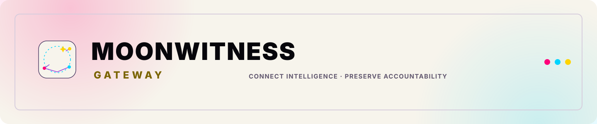
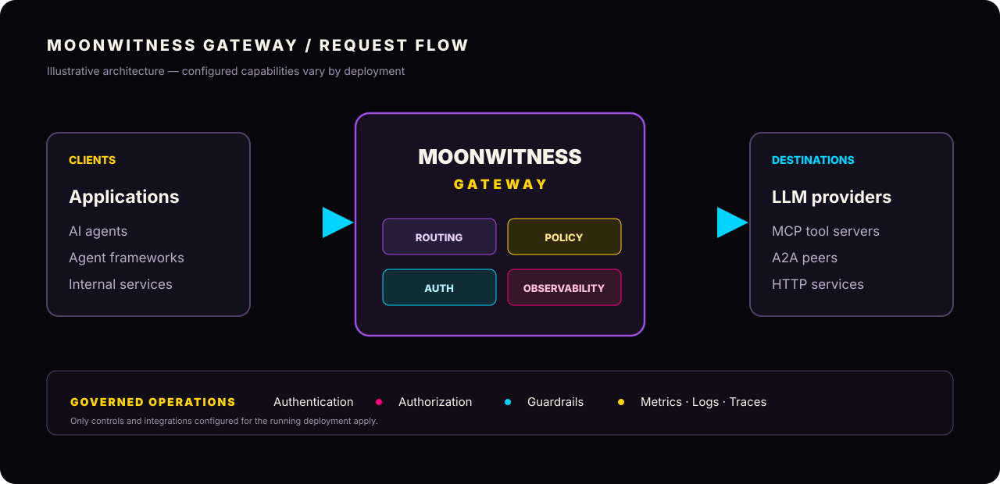

  <picture>
    <source media="(prefers-color-scheme: dark)" srcset="img/banner-light.svg">
    <source media="(prefers-color-scheme: light)" srcset="img/banner-dark.svg">
    
  </picture>
  
<strong>Connect Intelligence. Preserve Accountability.</strong>

  

    
    
    
  

  
<em>The Moon Watches. The Record Remembers. The Evidence Remains Inspectable.</em>

---

**Moonwitness Gateway** is an open-source AI connectivity gateway for routing and governing communication between applications, AI models, agents, tools, and external services.

It brings together LLM, Model Context Protocol (MCP), and Agent-to-Agent (A2A) connectivity behind a configurable proxy boundary, with security controls, policy enforcement, guardrail integrations, and operational observability.

Moonwitness Gateway is part of the broader **Moonwitness** technology vision: building systems where intelligence can connect and collaborate while operations remain inspectable and people remain responsible.

> **A gateway connects systems. It does not declare truth.**
>
> Model output is not automatically verified knowledge; an automated action is not human approval; and an observable request is not, by itself, proof that its content is correct.

  

## Why Moonwitness Gateway?

As AI systems evolve from isolated models into connected networks of agents, tools, and services, the connections between them become part of the security and reliability boundary.

Moonwitness Gateway provides a common place to configure those connections, apply policies, route traffic, and observe operational behavior.

Its design follows the Moonwitness XV principle:

**Preserve the original. Trace each claim. Respect each perspective. Investigate openly. Create freely. Keep humans responsible.**

For gateway infrastructure, that means:
- Make the path between clients, models, agents, and tools explicit.
- Apply authentication and authorization at defined boundaries.
- Keep routing and policy behavior configurable and reviewable.
- Emit operational signals that help teams investigate requests and failures.
- Keep humans accountable for policy, deployment, access, and consequential decisions.

## Core capabilities

The capabilities below describe the inherited Agentgateway implementation in this fork. Availability may depend on the selected deployment mode, configuration, provider, and external integrations.

### LLM Gateway
Route model traffic through a unified OpenAI-compatible API. The implementation supports multiple model providers and configuration patterns, including provider-specific routing, load balancing, failover, budget and spend controls, prompt enrichment, and related LLM policies.

### MCP Gateway
Connect model clients to tool servers and external data sources through the [Model Context Protocol](https://modelcontextprotocol.io/introduction). Supported connection patterns include tool federation, stdio and network transports, OpenAPI integration, and authentication flows such as OAuth.

### A2A Gateway
Enable agent-to-agent communication using the [Agent2Agent protocol](https://a2a-protocol.org/), including agent capability discovery and task-oriented collaboration.

### Inference routing
Support routing decisions for self-hosted and Kubernetes-based inference environments. Available routing signals depend on the configured inference integration and may include GPU utilization, queue depth, KV cache, and LoRA adapter information.

### Guardrails and policy enforcement
Configure layered controls through supported integrations such as regular-expression filters, moderation and guardrail providers, custom webhooks, and policy expressions. These controls enforce configured rules; they do not replace human governance or guarantee that model output is true.

### Security and observability
The inherited implementation includes authentication options such as JWT, API keys, and OAuth; fine-grained authorization with RBAC and CEL policies; rate limiting; TLS; and telemetry integrations for metrics, logs, and distributed tracing through OpenTelemetry.

## Architecture and responsibility boundaries

Moonwitness Gateway is the **connectivity and policy-enforcement layer**. It is not a second application hub, identity authority, canonical database, agent memory system, or human approval authority.

| Area | Responsibility |
|---|---|
| Gateway data plane | Route configured LLM, MCP, A2A, and HTTP traffic |
| Gateway policy | Enforce configured authentication, authorization, routing, and guardrail rules |
| Observability | Expose configured logs, metrics, and traces for operational review |
| Moonwitness XV / ARSY | Remains the wider ecosystem's application hub and canonical run-state owner |
| Human governance | Decisions, approvals, rights, and publication authority remain with accountable people and their designated systems |

Integrations with other Moonwitness XV components must use explicitly configured routes and contracts. Their existence in the wider vision does not imply that every integration is already implemented in this repository.

## Relationship to the Moonwitness ecosystem

Moonwitness Gateway supports the wider Moonwitness XV direction without claiming ownership of every capability in that ecosystem.

- **Moonwitness XV** defines the broader knowledge, witness, research, creativity, and accountable-action vision.
- **ARSY** is the single central application and orchestration hub in Moonwitness XV. Gateway does not replace it or become a second Hub.
- **AI Gateway** is the model connectivity and inference-routing capability in the ecosystem; deployments should define its relationship to this gateway explicitly rather than create duplicate routing authorities.
- **LUMEN** is the planned agent framework and controlled execution worker. Gateway connectivity does not grant an agent independent authority to approve its own actions.
- **HEADQUARTERS / 100CENTER** is the human governance and review surface.
- **ORBIT** is a planned operational interface, not a gateway backend or identity owner.

These are architectural boundaries and ecosystem relationships, not a claim that all listed integrations are shipped or certified in this repository.

## Getting started

The gateway retains the inherited standalone and Kubernetes deployment models.

- [Standalone quickstart](https://agentgateway.dev/docs/standalone/latest/documentation/quickstart)
- [Kubernetes quickstart](https://agentgateway.dev/docs/kubernetes/latest/documentation/quickstart)
- [Standalone documentation](https://agentgateway.dev/docs/standalone/latest)
- [Kubernetes documentation](https://agentgateway.dev/docs/kubernetes/latest)
- [Configuration examples in this repository](examples/)

The documentation links above currently point to the upstream Agentgateway documentation for inherited behavior. They are useful technical references, but they are not presented as a separately hosted Moonwitness documentation service.

## Built-in UI

Moonwitness Gateway includes a browser-based UI for inspecting and configuring the gateway surfaces exposed by the running instance. The UI uses the Moonwitness Gateway visual identity and retains the upstream implementation's existing API and configuration behavior.

The UI is an operational interface, not an independent source of authorization or truth. Access controls must be configured and verified at the gateway boundary.

## Design language

The dashboard follows the Moonwitness XV visual direction: **evidence-first moonpunk, zine-inspired contrast, clear hierarchy, and readable operational text**.

The palette is based on the canonical Moonwitness tokens:

| Token | Color | Role |
|---|---|---|
| Ink | `#07060b` | Primary dark canvas |
| Paper | `#0d0b14` / `#f7f4ec` | Surface and light canvas |
| Yellow | `#ffd400` | Primary accent and emphasis |
| Pink | `#ff007a` | Secondary accent |
| Cyan | `#00d4ff` | Signal and focus accent |
| Moon purple | `#9d4edd` | Identity and supporting accent |
| Chalk | `#f7f4ec` | High-contrast text |

Color is never the only carrier of status or meaning. Navigation, forms, errors, policy states, and operational information remain text-readable and keyboard accessible.

## Project identity and upstream provenance

This repository is a **Moonwitness-branded fork** of [agentgateway/agentgateway](https://github.com/agentgateway/agentgateway). The gateway engine, technical design, and many internal identifiers are inherited from that project.

- The upstream [Apache License 2.0](LICENSE) and source attribution are retained.
- This fork is independently branded as Moonwitness Gateway.
- Moonwitness Gateway is not the official Agentgateway project and is not endorsed by the Linux Foundation or upstream maintainers.
- Internal package names, APIs, resource identifiers, and command names may continue to use `agentgateway` where changing them would break compatibility. Such identifiers are not the public product brand.

## Documentation map
- [README](README.md) — product overview and getting started links
- [BLUEPRINT](BLUEPRINT.md) — product boundaries, architecture, brand, and design contract
- [Design documents](design/README.md) — upstream design-document contribution process
- [Architecture notes](architecture/README.md) — inherited architecture references
- [Examples](examples/) — deployment and configuration examples
- [Security policy](SECURITY.md) — vulnerability reporting guidance
- [License](LICENSE) — Apache License 2.0

## Project maturity

The current repository contains the inherited gateway implementation. This branding update does not certify a production deployment, security posture, provider integration, or compatibility with every upstream release.

Before production use, review the configuration, authentication and authorization policies, TLS setup, guardrail integrations, observability pipeline, resource limits, and deployment-specific security requirements. Validate changes with the repository's normal build and test workflows.

---

  <strong>MOONWITNESS GATEWAY</strong> 
  <em>Secure Connectivity. Observable Intelligence. Accountable Technology.</em>

